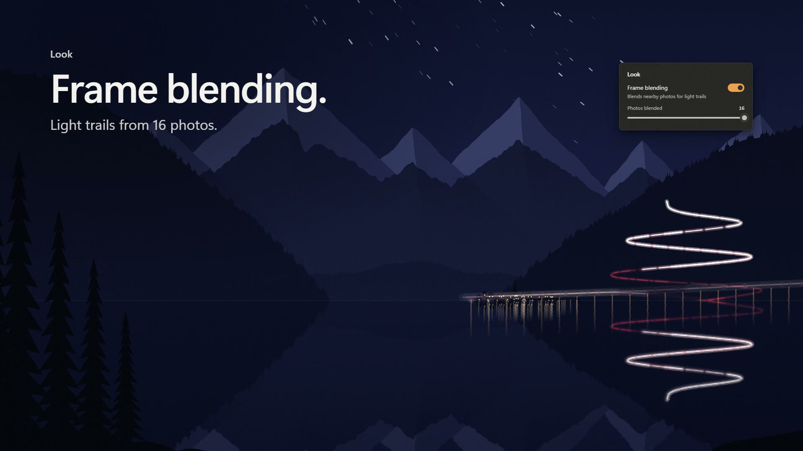

# 10Lapse motion reel

`10lapse-motion-reel-2026.mp4` is a 59-second motion piece about 10Lapse 3.1, made for Sven's portfolio
([borden.ch](https://borden.ch), which takes it through its `scripts/reels.json`): 1920 × 1080 at 60 fps, H.264 with
AAC stereo. It is stored in Git LFS: clone with git-lfs installed to get the video, otherwise the file is a small
pointer. The 30-second Store trailer is a different film, in [`docs/store/showreel/`](../store/showreel/README.md).



Nothing in it is edited by hand. Every frame comes from `source/reel.html` and the soundtrack from `source/music.py`,
on one timeline at 120 BPM: a one-second pickup, then a bar every 2 s starting on the odd seconds. The cuts land on
odd seconds, so the frame borden.ch's contact sheet takes every even second sits in the middle of a shot.

## What it shows

| Time | Beat |
|---|---|
| 0–3 s | The tripod: a mountain lake at 17:42, the camera's viewfinder, the shutter. "One photo every 5 seconds." |
| 3–7 s | The camera pulls back from photo 1 and flies through a tunnel of the evening's 1,440 photos, day to night. |
| 7–13 s | The last photo splits into five frames that turn to five times of day, then become the icon. "10Lapse." |
| 13–17 s | The start screen: a folder is dropped, the first frame develops, the strip fills, "1,440 photos → 48.0 s". |
| 17–23 s | Deflicker: the sunset flickers a third of a stop on every beat until the switch; the steps become a ramp. |
| 23–29 s | Crop and pan from a start framing to an end framing at 3×, as the export draws it; then every frame shape. |
| 29–35 s | Night falls; sixteen photos of car lights fan out in depth and fold into one frame of light trails. |
| 35–41 s | Hold, boomerang and music on a timeline; the waveform under it is this soundtrack's own. |
| 41–45 s | The export: frames pass the amber gate to 100 %, 4K, H.264 or HEVC, on the graphics card, or a GIF. |
| 45–49 s | "Mountain lake.mp4 is ready": the whole evening plays in four seconds. |
| 49–53 s | "Your photos never leave your PC." Offline, no account, no analytics. |
| 53–59 s | Five bars rise in the icon's colours and gather into it; the wordmark, the Store, the credit. |

The lake, the village and the pass road are drawn by `source/world.js` for any time of the evening, any framing and
any blend of photos (the light trails are the cars' 4-second exposures, sixteen of them averaged); there are no real
photos. The window is rebuilt in HTML from `DESIGN.md`'s tokens with the app's own strings (`src/TenLapse.Presentation/Strings`),
and the reel claims only what 3.1 does, as `docs/store/listing.md` words it.

The sound follows the picture: the shutter on the frames the viewfinder counts, one tick per ring of photos the
camera passes, the slices turning, the pad pumping with the flicker until deflicker is switched on, a figure played
out and back for the boomerang, the lock closing, and one last shutter at the end of the evening. Integrated loudness
is about −15.7 LUFS with true peaks at −1 dBTP.

## Make it again

Needs Node 18 or later with `playwright-core` and a Chromium build, Python 3 with NumPy and Pillow, ffmpeg, and the
Segoe UI Variable fonts (Windows 11). From `source/`, with `PLAYWRIGHT_CORE` pointing at a `playwright-core` package
folder and `CHROME` at a Chromium or `chrome-headless-shell` executable when they are not installed where Node finds them:

```powershell
python music.py music.wav wave.js                      # wave.js feeds the Music beat's waveform
node render.mjs video 60 0 6 | python accum.py part_00.mp4 60 1.3 0
node render.mjs video 60 6 16 | python accum.py part_06.mp4 60 1.3 360
# ... and so on for 16-28, 28-42 and 42-59 (the last argument is the first frame, from x 60); then join them:
'file part_00.mp4', 'file part_06.mp4', 'file part_16.mp4', 'file part_28.mp4', 'file part_42.mp4' | Set-Content parts.txt
ffmpeg -f concat -safe 0 -i parts.txt -c copy frames.mp4
$x264 = '-c:v libx264 -preset slower -tune film -x264-params aq-mode=3:aq-strength=0.9 -b:v 8000k -maxrate 12000k -bufsize 24000k -pix_fmt yuv420p -colorspace bt709 -color_primaries bt709 -color_trc bt709 -color_range tv'.Split(' ')
ffmpeg -i frames.mp4 @x264 -pass 1 -an -f mp4 NUL
ffmpeg -i frames.mp4 -i music.wav -map 0:v -map 1:a @x264 -pass 2 -c:a aac -b:a 192k -movflags +faststart -shortest 10lapse-motion-reel-2026.mp4
```

`render.mjs` steps the page through `window.renderAt(t)` and screenshots it. Each frame averages 3 to 24 samples
across a 180° shutter (`window.samplesAt`), which is the motion blur; `accum.py` averages them, adds a fine grain that
also dithers the gradients, and writes a near-lossless intermediate. The five ranges run at once in about a quarter of
an hour on a 16-thread PC. `node render.mjs stills <folder> 2,8,34` writes single frames for checking.

Two checks before a new version ships. Readability: every title stays whole and still for at least 0.4 s plus one
second per 15 characters (Popote's showreel rule, which borden.ch's reels follow); the sub-lines are short for that
reason. Flashes: `python flashes.py ../10lapse-motion-reel-2026.mp4` counts WCAG 2.3.1 general and red flashes per
second the way Popote's showreel check does, and exits 1 if any second fails (borden.ch's gate G4 asks it of every
published film). That is why the viewfinder's shutter flash is faint and the export's film row moves under three
frames a second.
